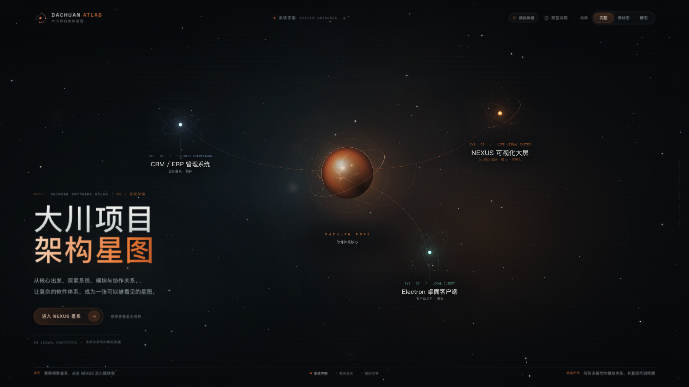
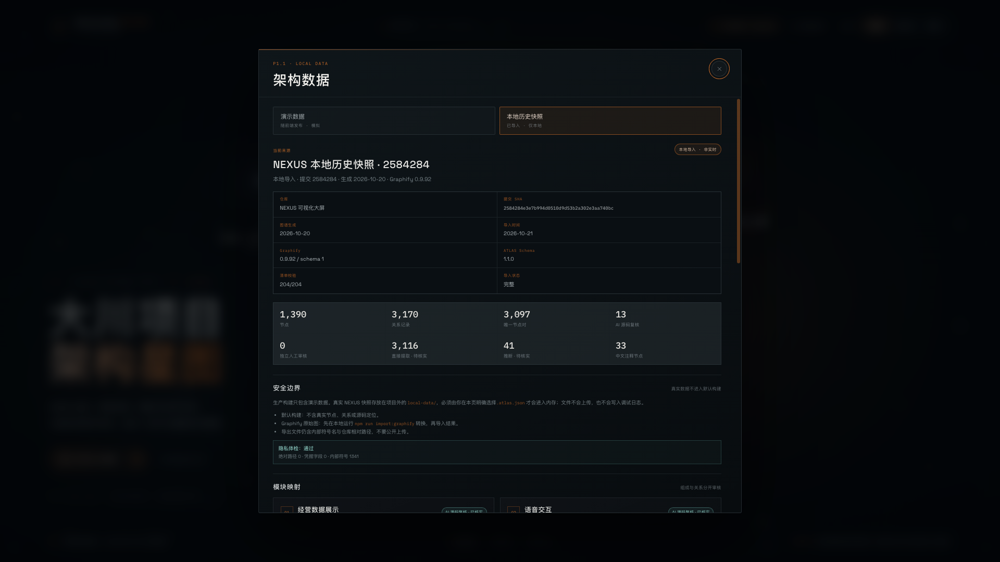
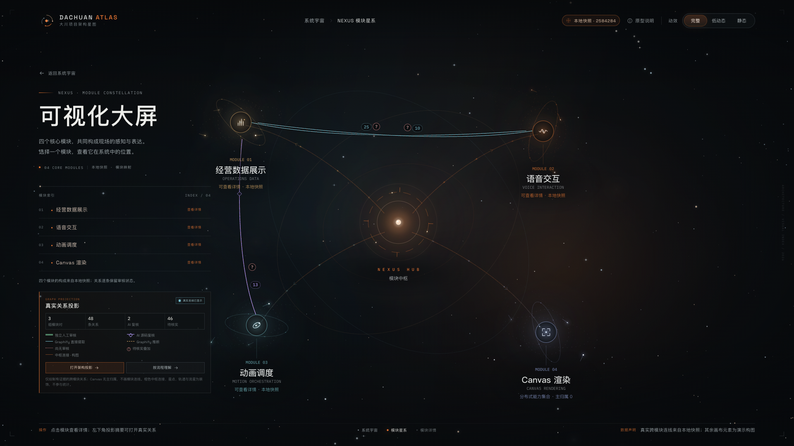
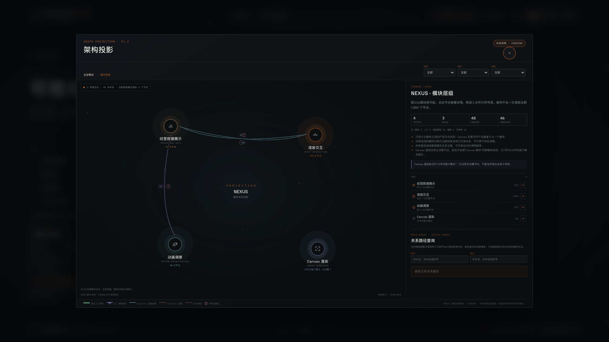
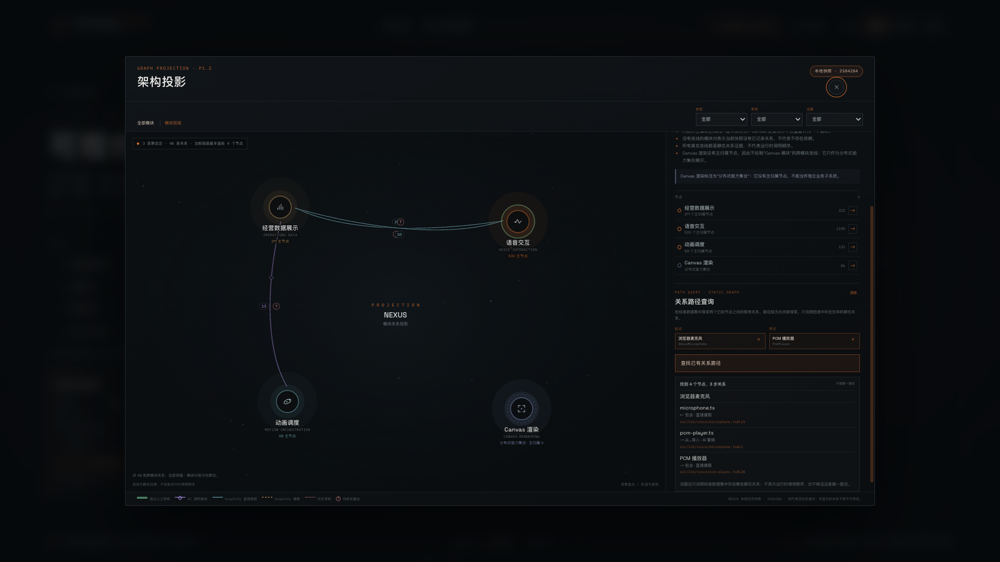
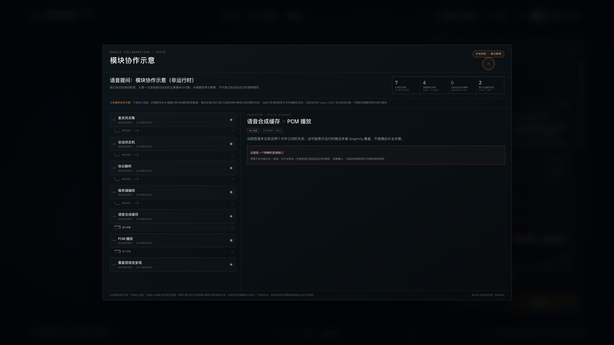
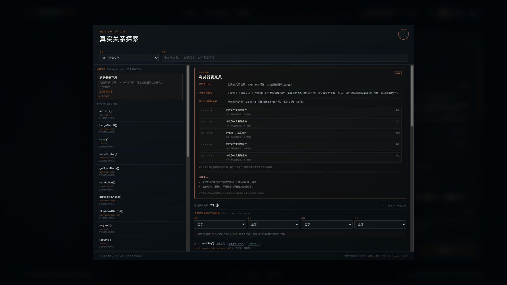
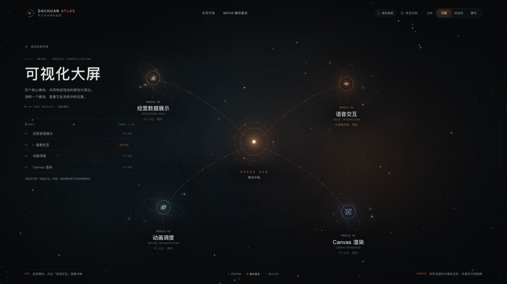
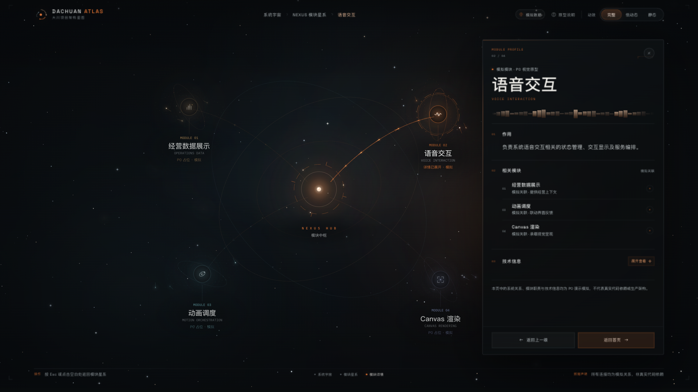

# DACHUAN ATLAS · 大川项目架构星图

> **P1.3 可信架构解释 + P1.2 真实架构投影 + P0.1 视觉原型。** 默认构建只包含演示数据；真实 NEXUS 快照需在本地明确导入。模块、文件与符号探索默认展示中文解释，技术细节可展开；语音场景改称「模块协作示意」，严格区分概念步骤、静态关联、已验证运行时顺序与证据缺口。NEXUS 模块层会绘制有证据的跨模块连线。模块位置、中枢连接、星点、轨道与流星仍是演示构图。CRM / Electron 尚未接入真实架构数据。

一套用于评估「电影式宇宙星系 × 未来数字神经网络」视觉语言的独立前端原型，并在此基础上验证 Graphify 架构数据能否被可靠读取。它把 DACHUAN 软件体系映射为一座可探索的系统宇宙，通过三级镜头运动串联：**系统宇宙 → NEXUS 模块星系 → 模块详情 / 架构投影 / 模块协作示意**。



---

## 1. 如何运行

测试环境：macOS 15.7.8 / Apple M1 Ultra / Node.js 24.21.0。  
要求：Node.js `^20.19.0 || >=22.12.0`，现代 Chrome / Edge 浏览器。

```bash
cd "DACHUAN ATLAS"
npm install
npm run dev
```

终端会显示本地地址，默认为：

**http://127.0.0.1:4173**

生产构建与预览：

```bash
npm run build
npm run preview
```

测试、本地转换与构建门禁：

```bash
npm test
npm run import:graphify -- --graphify "../graphify-poc" \
  --expect-commit 2584284e3e7b994d0510d9d53b2a302e3aa740bc
npm run attach:flows
npm run build
npm run verify:build
```

P1.3 浏览器验收、性能对照与备份审计需要本地 preview 已启动：

```bash
node tools/verify-p13.mjs          # 独立 Chrome；语义、中文解释、理解检查、导出重导入
HEADFUL=1 node tools/perf-p12.mjs  # 可见 Chrome；性能对照（结果另存为 p1.3-performance.json）
node tools/audit-backup.mjs        # 隔离目录恢复、测试、构建、真实数据重新导入
```

`npm test` 不依赖 Graphify 目录；设置 `GRAPHIFY_POC_DIR` 可额外重跑原始 `graph.json` 的一致性测试。真实快照输出到 `local-data/`（已忽略），不会进入 `public/` 或 `dist/`。`attach:flows` 只把本地模块协作场景附加到已有快照，不扫描源码工作区；场景文件同样位于 `local-data/`，不进入默认构建。项目运行时不请求任何第三方服务。

---

## 2. 本轮体验路径

| 层级 | 可做的事 |
| --- | --- |
| 系统宇宙 | 悬停查看星系中文名称与模拟说明；点击 NEXUS 进入模块层；点击 CRM / Electron 可选中并查看简要信息 |
| NEXUS 模块星系 | 本地快照导入后绘制有证据的跨模块连线；左下角投影摘要区分证据线型与构图线，并可打开架构投影 / 模块协作示意 / 5 题理解检查 |
| 模块详情 | 默认显示「用中文理解」：负责什么、为什么需要、已记录联系、仍需确认；组成与内部关系分开呈现；Canvas 明确标记为分布式能力集合 |
| 架构投影 | 模块 → 文件 → 符号渐进展开；默认先显示中文解释，技术标识与完整证据在可展开区域；支持类型 / 审核 / 证据筛选 |
| 模块协作示意 | 7 个 AI 概念步骤；每一步有源码来源，4 个衔接有静态关系，2 个衔接明确标为缺少证据；0 个衔接被验证为运行时顺序 |
| 路径探索 | 在两个已知产品节点之间查询既有静态关系；无路径时显示“当前图谱未发现关系路径” |
| 关系探索 | 默认中文解释 + 中性关系摘要；技术名称、路径、类型与完整证据在可展开区域；支持中文/文件/符号搜索与筛选 |
| 架构数据 | 点击右上角数据徽标，默认演示数据；选择本地 `.atlas.json` 后才加载真实快照，并查看仓库/快照登记、隐私体检、导入导出 |

其他辅助操作：

- 点击画布空白处返回或取消选中。
- `Esc` 关闭弹窗、详情或返回上一级。
- 右上角「动效」可在 **完整 / 低动态 / 静态** 间切换，选择会保存在本机浏览器中。
- 系统若启用「减少动态效果」，首次访问会自动使用静态模式。

首屏 CTA 与 NEXUS 模块索引都提供了可键盘操作的替代入口；Canvas 中的星系本身同样支持鼠标悬停和点击。

---

## 3. P1.1 本地数据探索 + P1.2 真实架构投影

P1.1 在 P0.1 视觉层之上完善本地数据探索。**真实 NEXUS 快照不进入默认构建**，只存放在项目外的 `local-data/`（已加入 `.gitignore`），由用户在本地面板明确选择 `.atlas.json` 导入。P1.2 在标准数据与 Canvas 之间增加了独立的 Graph Projection 层。

| 数据来源 | 内容 | 界面标识 |
| --- | --- | --- |
| 演示数据 | P0.1 模拟节点 / 关系，`SIMULATED`，随前端发布 | 顶栏「演示数据」 |
| 本地历史快照 | 用户导入的 ATLAS 1.3 数据；当前样例 1,390 节点 / 3,170 条关系 / 1 个模块协作场景 / 4 个模块解释 | 顶栏「本地快照 · 2584284」 |

安全与审核边界：

- 生产构建 `dist` 不含真实快照文件、提交 SHA、内部符号或源码路径；`npm run verify:build` 会检查。CLI 拒绝写入 `public/`。
- Graphify 原始 `graph.json` 先在本地 CLI 转换为 ATLAS 标准数据；浏览器只导入转换结果，不携带 NEXUS 专属规则。
- 13 条关系是 **AI 源码复核**，不是独立人工审核；独立人工审核为 **0**。另有 3,116 条直接提取、41 条推断仍待核实。
- 导入导出均有隐私体检；导出文件仍含内部符号名与相对路径，不要公开上传。

四个模块现在都可打开真实详情：一句话介绍、已核实职责、3–5 个代表对象、组成/关系分开审核、源码证据与待核实事项。Canvas 标记为分布式 Canvas 2D 能力集合，不是独立业务子系统。



关系探索支持模块 → 文件 → 符号渐进浏览，按关系类型、审核状态、证据类型和方向筛选；中文模块名、中文节点名、文件名和符号都可搜索。

### 3.1 P1.2 Graph Projection

```text
ATLAS 标准数据集 → 关系筛选与聚合 → 星图布局数据 → Canvas 2D
```

- Canvas 只消费 `GraphProjection`，不读取 Graphify 原始 `graph.json`。
- 模块级投影按数据集对象缓存一次；文件 / 符号层按导航焦点缓存。渲染循环只绘制缓存的点和边，不重新聚合 1,390 个节点。
- 模块边只来自 `scope=product` 且两侧都有主模块的关系；同一对模块按方向聚合，保留每条关系的事实、审核方式和源码定位。
- 默认只绘制模块层；点击后进入文件层，再进入符号层。当前上限：模块 4、文件 9、符号 14 个节点；未显示的节点会给出数量说明。
- 演示模式不生成任何真实跨模块边，保留原有星系构图。

当前本地快照的模块级结果：

| 方向 | 关系数 | 证据 |
| --- | --- | --- |
| 语音交互 → 经营数据展示 | 25 | Graphify 直接提取 · 25 条待核实 |
| 经营数据展示 → 语音交互 | 10 | Graphify 直接提取 · 10 条待核实 |
| 经营数据展示 → 动画调度 | 13 | 11 条直接提取 + 2 条 AI 源码复核 · 11 条待核实 |
| Canvas 渲染 | 0 | 主归属节点为 0；只作为分布式能力集合展示，不伪造模块连线 |

真实连线与装饰必须可分：

| 样式 | 含义 |
| --- | --- |
| 青灰实线 | Graphify 直接提取 |
| 琥珀虚线 | Graphify 推断 |
| 紫色实线 + 菱形 | AI 源码复核 |
| 绿色双线 | 独立人工审核 |
| 红色点线叠加 + `?` | 仍有待核实关系 |
| 橙色中枢连接 / 星点 / 轨道 / 流星 | 构图装饰，不参与架构统计 |



### 3.2 架构投影工作台

模块 → 文件 → 符号逐级展开；支持关系类型、审核状态、证据类型筛选，节点列表，上游 / 下游，聚合边证据样本与源码定位。当前层最多渲染 4 / 9 / 14 个节点，避免一次绘制全图。



### 3.3 路径探索

- 在任意两个已知 **产品节点** 之间做无向静态关系搜索，最多 6 步；测试节点、工具脚本和外部包不参与路径，避免把测试夹具当成架构路径。
- 路径结果保留每一步的关系类型、方向、审核来源与源码定位。
- 没有路径时固定显示 **“当前图谱未发现关系路径”**，并说明“这不表示两个模块没有关系”。
- 路径只说明图谱中存在怎样的静态关系，不宣称运行时调用顺序。



### 3.4 模块协作示意（P1.3 语义修正）

语音场景「语音提问：从麦克风到覆盖层」保留 7 步和 2 个缺口，但不再称为“流程”。界面固定显示四层语义：

| 层 | 当前数量 | 含义 |
| --- | --- | --- |
| AI 概念步骤 | 7 | AI 根据已核对模块职责整理，不代表执行顺序 |
| 源码静态关联 | 4 | 相邻步骤文件之间确有导入/引用等静态关系 |
| 已验证运行时顺序 | 0 | 没有 trace、日志或协议测试证据 |
| 缺少证据的衔接 | 2 | 音频缓存 → PCM 播放、PCM 播放 → 覆盖层没有图边 |

- 缺口不补线，不把步骤顺序描述成已验证的运行时调用。
- 每一步仍能展开到当前快照中的真实文件、符号与源码证据。
- 场景审核为 **AI 源码复核**，独立人工审核为 0。
- 本地附加工具只读取已有快照，不扫描 NEXUS 工作区。



### 3.5 中文解释层与理解检查

- 模块详情、关系探索和架构投影默认先显示「用中文理解」：它负责什么、为什么需要它、与当前对象有什么已记录联系、仍需确认什么。
- 没有经核对中文说明的文件/符号明确显示“未收录，不自动生成”，不会用模型补写。
- 原始符号、源码路径、关系类型与完整证据都在“技术细节 / 源码证据”折叠区。
- 「理解检查 · 5 题」覆盖 NEXUS 功能领域、语音主要组件、动画调度器、Canvas 边界和图谱连接含义；结果仅用于自我检查，不是认证。



### 3.6 备份与多仓库准备

- 隔离目录从 Git bundle 恢复 → `npm ci` → `npm test` → `npm run build` → `verify:build` → 浏览器重新导入真实快照；结果见 [p1.3-backup-audit.json](docs/architecture/p1.3-backup-audit.json)。
- Mac → Windows 的完整文件清单、SHA-256 校验、PowerShell 命令和验收清单见 [P1.3-MAC-TO-WINDOWS.md](docs/P1.3-MAC-TO-WINDOWS.md)。
- Schema 1.3 增加可选的仓库登记、快照标识、跨仓库关系范围与运行时边界；CRM / Electron 只完成设计，没有扫描或导入。详见 [P1.3-MULTI-REPO.md](docs/P1.3-MULTI-REPO.md)。

完整报告：[P1.3-REPORT.md](docs/P1.3-REPORT.md) · P1.2 报告：[P1.2-REPORT.md](docs/P1.2-REPORT.md) · Schema：[ATLAS-SCHEMA.md](docs/architecture/ATLAS-SCHEMA.md) · 模块证据：[NEXUS-MODULE-EVIDENCE.md](docs/architecture/NEXUS-MODULE-EVIDENCE.md)

```bash
npm run import:graphify -- --graphify "../graphify-poc" \
  --expect-commit 2584284e3e7b994d0510d9d53b2a302e3aa740bc
npm run attach:flows
npm run build
npm run verify:build
```

---

## 4. P0.1 视觉优化

本轮不改变三级交互和产品范围，只提升既有场景的镜头、能量与阅读质量。

- **镜头纵深**：星空拆成远景 / 中景 / 近景三层视差，加入轻微前景尘埃与相机速度拖影；进入 NEXUS 时使用收缩的到达光圈，让目标星系成为镜头焦点。
- **连续缩放**：NEXUS 星系不再与模块中枢简单交叉淡化；中枢从系统形态连续放大，四个模块沿弧线从中心展开，关系线随展开进度生长。
- **文字退场**：首页与模块层改为“先退后进”的分层转场，旧标题完全退出后新标题才进入，避免叠字和跳切。
- **能量细节**：核心内部增加反向旋转能量虹膜与带尾迹的能量微粒；系统、中枢和模块拥有不同相位的呼吸光晕；流星尾迹更长，关系光流增加双段尾迹与焦点光波。
- **模块星系**：每个模块增加两条微轨道与三颗局部卫星，并按前后景遮挡关系绘制，使模块从“图标”变成小型星系。
- **装饰语义**：微卫星与细轨道是独立于模块数据的程序化装饰层，不参与悬停、点击、详情或架构关系；About 面板中有明确说明。
- **可读性**：提升模块名称、说明、系统状态与详情面板辅助文字的对比度；焦点之外的节点仍保留可见度，并使用局部暗色底衬平衡核心光晕。

详细改动与本轮性能对照见 **[docs/P0.1-REPORT.md](docs/P0.1-REPORT.md)**。

---

## 5. 视觉与技术方案

- **React + TypeScript + Vite**，不依赖 Three.js、GSAP 或其他动画库。
- 星空、中央能量核心、系统星系、关系曲线与流动光点均由 **Canvas 2D** 实时绘制。
- 光晕、星尘、扫光、细腻噪声与界面层次由 CSS 和本地字体共同完成。
- 所有图形为程序化原创生成，没有使用任何参考项目的源码或视频素材。

### 视觉构成

- **中央数字核心**：多层球形光体、内部旋转能量弧、倾斜轨道、呼吸光晕、能量波纹与少量绕行粒子。
- **三个系统星系**：不同的主色、尺度、轨道与粒子节奏；悬停时聚焦对应连接线。
- **关系流**：预采样三次贝塞尔曲线，沿路径运行的双段光尾表达方向；非焦点连接自动弱化但保持可见。该光流只属于构图连线，真实架构边不运行光流。
- **真实架构边**：由 Graph Projection 提供，使用证据线型、计数与待核实标记；不与装饰光流共用动画语义。
- **镜头层级**：进入 NEXUS 时，镜头平滑推进并聚焦到目标星系，模块从中枢连续展开；详情打开时镜头轻微让位于右侧面板。
- **模块微星系**：模块外圈的卫星和微轨道仅用于视觉构图，不属于数据节点。
- **投影画布**：模块固定构图；文件 / 符号按焦点环与关联环布局，背景星点与轨道仅作装饰。

### 动效与性能控制

| 模式 | 行为 |
| --- | --- |
| 完整 | 完整星空漂移、前景尘埃、流星、光流、核心能量与呼吸光晕 |
| 低动态 | 降低运动速度与粒子密度，取消流星，放缓 CSS 环境动效 |
| 静态 | 停止 canvas 连续帧循环与 CSS 环境动画，悬停仍可获得即时反馈 |

此外：

- 支持 `prefers-reduced-motion: reduce`：首次访问默认进入静态模式。
- 页面失焦时 Canvas 降至约 20 FPS 并暂停 CSS 环境动画。
- 页面不可见时停止动画帧。
- Canvas 设备像素比上限为 1.75，同时将画布单边限制在 4096 px，避免高 DPI 大屏重复像素填充。
- 关系曲线、发光纹理、标签底衬在初始化阶段缓存，不在每帧重建节点拓扑或复杂渐变。
- 组件卸载时移除动画帧、ResizeObserver、鼠标与可见性监听器。

---

## 6. 实测结果摘要

完整 P0.1 记录见 **[docs/P0.1-REPORT.md](docs/P0.1-REPORT.md)**；P0 基线见 [docs/TEST-REPORT.md](docs/TEST-REPORT.md)。

测试时间：2026-10-20  
测试设备：Apple M1 Ultra / 64 GB / macOS 15.7.8 / 内置显示器 1920×1080 @ 100 Hz  
测试浏览器：ZCode 内置 Chromium 浏览器（Chromium 146.0.7680.80 / Electron 41.0.3）

| 场景 | 分辨率 | P0 Canvas 平均 / p95 | P0.1 Canvas 平均 / p95 | P0.1 FPS |
| --- | --- | --- | --- | --- |
| 首页 · 完整动效 | 1920×1080 | 0.89 / 1.7 ms | 1.06 / 2.3 ms | 99.8–100.2 |
| 首页 → NEXUS 转场 | 1920×1080 | 1.19 / 2.0 ms | 0.96 / 2.1 ms | 99.8–100.1 |
| 语音交互详情 | 1920×1080 | 1.14 / 2.9 ms | 0.91 / 1.8 ms | 99.9–100.2 |
| 首页 · 完整动效 | 2560×1440 | 1.31 / 2.3 ms | 1.22 / 2.7 ms | 100.1 |
| 首页 · 完整动效 | 3840×2160 | 0.74 / 0.8 ms | 0.86 / 1.0 ms | 99.9–100.1 |
| 首页 → NEXUS 转场 | 3840×2160 | 1.13 / 2.4 ms | 0.88 / 1.0 ms | 100.1 |

- 显示器刷新率为 100 Hz，因此 100 FPS 是本次环境的采样上限；P0.1 的 95% 帧间隔最高为 11.9 ms。
- 1080p 首页的平均 Canvas 绘制增加约 0.17 ms；其余场景在运行波动范围内。
- 4K 转场曾因全屏文字 blur 降至约 95 FPS，移除全屏滤镜后恢复 100.1 FPS，最终代码已包含该修正。
- 失焦降载约 19.6 FPS；静态模式停止连续 rAF；低动态约 100 FPS。

注意：

- 上述帧率为浏览器 `requestAnimationFrame` 采样与实际 Canvas 绘制耗时，不等同于完整 GPU 合成链路的专业帧分析。
- 2560×1440 与 3840×2160 通过 Chromium 视口渲染验证，尚未在物理显示器上验收。
- 性能数字仅对本次 M1 Ultra 测试环境负责。
- P1.1 默认演示模式实测：完整 100.1 FPS / 0.65 ms / p95 0.8 ms；低动态 99.9 FPS；静态 `rafActive:false`。Canvas 引擎未改动，详见 [P1.1-REPORT.md](docs/P1.1-REPORT.md)。

### P1.2 实测（2026-10-21，可见 Chrome）

测试环境：Apple M1 Ultra / 64 GB / macOS 15.7.8 / 内置显示器 1920×1080 @ 100 Hz。

浏览器：独立 Google Chrome，可见窗口；CDP 开启 focus emulation；页面自报 `requestAnimationFrame` 与 Canvas 绘制耗时。

| 场景 | 分辨率 | 平均 / p95 绘制 | FPS | 备注 |
| --- | --- | --- | --- | --- |
| 演示 · 完整 | 1920×1080 | 1.34 / 2.40 ms | 100.0 | 原有星系构图 |
| 真实快照 · 完整 | 1920×1080 | 0.68 / 1.00 ms | 100.0 | 3 条真实跨模块边 |
| 架构投影 · 模块层 | 1920×1080 | 0.23 ms | 100.0 | 4 节点 / 3 边 |
| 真实快照 · 低动态 | 1920×1080 | 1.28 / 2.25 ms | 100.0 | |
| 真实快照 · 静止 | 1920×1080 | 1.19 / 2.30 ms | 连续 rAF 停止 | `rafActive:false` |
| 真实快照 · 完整 | 2560×1440 | 1.25 / 2.88 ms | 100.0 | 浏览器视口 |
| 真实快照 · 完整 | 3840×2160 | 1.21 / 2.85 ms | 100.0 | 浏览器视口 |

- 100 FPS 是 100 Hz 显示器的采样上限，不代表更高刷新率设备的上限。
- 架构投影把关系聚合与曲线布局放在投影/缩放时执行，不在每帧重算。
- 4K 是 Chromium 视口渲染，不是物理 4K 显示器验收。
- 原始采样与说明：[p1.2-performance.json](docs/architecture/p1.2-performance.json)。

### P1.3 实测（2026-10-21，可见 Chrome）

P1.3 没有改 Canvas 引擎；新增中文解释与弹窗只在交互时渲染。同一环境下复测：

| 场景 | 分辨率 | 平均 / p95 绘制 | FPS | 备注 |
| --- | --- | --- | --- | --- |
| 演示 · 完整 | 1920×1080 | 1.06 / 2.10 ms | 100.0 | |
| 真实快照 · 完整 | 1920×1080 | 0.95 / 1.85 ms | 100.0 | 3 条真实跨模块边 |
| 架构投影 · 模块层 | 1920×1080 | 0.32 ms | 99.8 | 4 节点 / 3 边 |
| 真实快照 · 完整 | 2560×1440 | 1.57 / 2.75 ms | 100.0 | 浏览器视口 |
| 真实快照 · 完整 | 3840×2160 | 1.63 / 2.92 ms | 99.9 | 浏览器视口 |

- 原始采样：[p1.3-performance.json](docs/architecture/p1.3-performance.json)。
- 与 P1.2 的差异在运行波动范围内；没有新增逐帧计算。

---

## 7. 验收状态

| 项目 | 状态 |
| --- | --- |
| TypeScript 类型检查 | 通过 |
| 生产构建 | 通过 |
| 1920×1080 布局 / 三级交互 | 通过 |
| 2560×1440 布局 | 通过（浏览器视口渲染） |
| 3840×2160 布局 | 通过（浏览器视口渲染） |
| 完整 / 低动态 / 静态 | 通过 |
| 失焦降载 | 通过（合成 blur/focus 事件验证） |
| `prefers-reduced-motion` | 已实现初始偏好检测；未做系统辅助功能级自动化实测 |
| Windows 运行 | **待 Windows 验收** |
| 独立安装的 Chrome / Edge | P1.1 与 P1.2 已用独立 Google Chrome 完成本地导入、投影、流程、路径与导出验收（CDP 注入 file input）；Edge 待验 |
| 物理 2560×1440 / 4K 显示器 | 待真机验收 |
| P1.2 架构数据单元测试 | 通过（93 项通过 + 1 项跳过，10 个测试文件；含投影、路径、流程、安全） |
| P1.2 默认构建安全门禁 | 通过；dist 无快照、提交 SHA、内部符号、源码路径或流程场景 |
| P1.2 NEXUS 真实星图 | 通过（独立 Chrome；3 组模块对 / 48 条关系；Canvas 0 主归属不画线） |
| P1.2 架构投影渐进展开 | 通过（模块 4 / 文件 9 / 符号 14 节点上限；筛选；路径） |
| P1.2 按流程理解 | 通过（7 步；4 个有图边；2 个明确缺口；0 人工审核） |
| P1.2 导出 / 重新导入 | 通过（1,390 / 3,170 / 1 流程 / Schema 1.2.0） |
| P1.2 1440p / 4K | 通过（浏览器视口；无横向溢出） |
| P1.2 性能对照 | 通过（可见 Chrome；见上表） |
| P1.2 交互录屏 | 完成（50.6 秒，1440×810，30 FPS） |
| P1.3 语义区分 | 通过（7 概念步骤 / 4 静态关联 / 0 运行时顺序 / 2 缺口） |
| P1.3 中文解释层 | 通过（模块 / 文件 / 符号默认中文；技术细节折叠） |
| P1.3 理解检查 | 通过（5 题；全对 5/5、全错 0/5） |
| P1.3 多仓库兼容性 | 通过单元测试（仓库前缀、快照标识、跨仓库/跨进程规则） |
| P1.3 备份隔离恢复 | 通过（bundle → 测试 → 构建 → 浏览器导入；见审计 JSON） |
| P1.3 测试 | 通过（113 项通过 + 1 项跳过，14 个测试文件） |
| P1.3 构建安全门禁 | 通过；dist 无快照、提交 SHA、内部符号、源码路径或流程场景 |
| P1.3 Windows 实机 | **待 Windows 验收** |
| P1.1 四模块真实详情 | 通过（独立 Chrome + 截图） |
| P1.1 关系搜索 / 筛选 | 通过（23 条关系；AI 筛选 4 条） |
| P1.1 旧 Schema 1.0 兼容 | 通过单元测试迁移 |
| P1.1 / P1.2 Windows CLI / 路径 | 路径逻辑通过单元测试；未在 Windows 实机执行 |

P0.1 没有接入 Graphify；P1.1 / P1.2 只接入用户本地导入的 Graphify 历史快照，没有安装 Graphify Cloud、MCP 或 Agent Skill，也没有读取或修改现有 CRM/ERP、NEXUS 正式项目。P1.2 / P1.3 只读取已有的本地 `.atlas.json`，没有重新扫描 NEXUS 工作区。真实连线与模块协作场景都不进入默认构建。

---

## 8. 截图与录屏

### 关键状态

| 画面 | 文件 |
| --- | --- |
| 首页 · 1920×1080 | [查看](docs/screenshots/01-home-1920x1080.png) |
| 悬停 NEXUS 星系 | [查看](docs/screenshots/02-hover-nexus-1920x1080.png) |
| NEXUS 模块星系 · 1920×1080 | [查看](docs/screenshots/03-nexus-modules-1920x1080.png) |
| 语音交互详情 | [查看](docs/screenshots/04-voice-detail-1920x1080.png) |
| 技术信息展开 | [查看](docs/screenshots/05-voice-tech-expanded-1920x1080.png) |
| 选中 CRM / ERP 星系 | [查看](docs/screenshots/11-selected-crm-1920x1080.png) |
| 静态模式 | [查看](docs/screenshots/10-static-mode-1920x1080.png) |
| 首页 · 2560×1440 | [查看](docs/screenshots/06-home-2560x1440.png) |
| 首页 · 3840×2160 | [查看](docs/screenshots/07-home-3840x2160.png) |
| NEXUS · 3840×2160 | [查看](docs/screenshots/08-nexus-3840x2160.png) |
| 语音交互详情 · 3840×2160 | [查看](docs/screenshots/09-voice-detail-3840x2160.png) |





所有截图均由实际运行的页面通过浏览器截图获得，不是后期合成效果图。

### P1.3 可信解释与备份截图

| 画面 | 文件 |
| --- | --- |
| NEXUS 真实星图 · 1920×1080 | [查看](docs/screenshots/P1.3-01-nexus-real-1920x1080.png) |
| 仓库与快照登记 | [查看](docs/screenshots/P1.3-02-repositories-1920x1080.png) |
| 模块详情 · 中文解释 | [查看](docs/screenshots/P1.3-03-module-plain-1920x1080.png) |
| 模块协作示意 · 四层语义 | [查看](docs/screenshots/P1.3-04-flow-semantics-1920x1080.png) |
| 关系探索 · 中文优先 | [查看](docs/screenshots/P1.3-05-explorer-plain-1920x1080.png) |
| 理解检查 · 5 题 | [查看](docs/screenshots/P1.3-06-comprehension.png) |
| 架构投影 · 中文解释 | [查看](docs/screenshots/P1.3-07-graph-plain-1920x1080.png) |
| 演示模式回归 | [查看](docs/screenshots/P1.3-08-demo-regression-1920x1080.png) |
| NEXUS 真实星图 · 1440×810 | [查看](docs/screenshots/P1.3-09-nexus-real-1440x810.png) |
| NEXUS 真实星图 · 3840×2160 | [查看](docs/screenshots/P1.3-10-nexus-real-3840x2160.png) |

### P1.2 真实架构投影截图

| 画面 | 文件 |
| --- | --- |
| NEXUS 真实跨模块连线 · 1920×1080 | [查看](docs/screenshots/P1.2-01-nexus-real-1920x1080.png) |
| 架构投影 · 模块层 | [查看](docs/screenshots/P1.2-02-graph-modules-1920x1080.png) |
| 架构投影 · 文件层 | [查看](docs/screenshots/P1.2-03-graph-files-1920x1080.png) |
| 架构投影 · 符号层 | [查看](docs/screenshots/P1.2-04-graph-symbols-1920x1080.png) |
| 路径查询 · 已找到路径 | [查看](docs/screenshots/P1.2-05-path-query-1920x1080.png) |
| 路径查询 · 未发现路径 | [查看](docs/screenshots/P1.2-06-no-path-1920x1080.png) |
| 模块详情 · 跨模块关系 | [查看](docs/screenshots/P1.2-07-module-relations-1920x1080.png) |
| 模块详情 · 关系与入口 | [查看](docs/screenshots/P1.2-07b-module-links-1920x1080.png) |
| 按流程理解 · 图谱缺口 | [查看](docs/screenshots/P1.2-08-flow-gap-1920x1080.png) |
| 演示模式回归 | [查看](docs/screenshots/P1.2-09-demo-regression-1920x1080.png) |
| NEXUS 真实连线 · 1440×810 | [查看](docs/screenshots/P1.2-10-nexus-real-1440x810.png) |
| 架构投影 · 1440×810 | [查看](docs/screenshots/P1.2-11-graph-1440x810.png) |
| NEXUS 真实连线 · 3840×2160 | [查看](docs/screenshots/P1.2-12-nexus-real-3840x2160.png) |

### P1.1 本地数据探索截图

| 画面 | 文件 |
| --- | --- |
| 本地 ATLAS 导入与安全边界 | [查看](docs/screenshots/P1.1-01-local-import-1920x1080.png) |
| 经营数据展示详情 | [查看](docs/screenshots/P1.1-02-module-1-1920x1080.png) |
| 语音交互详情 | [查看](docs/screenshots/P1.1-03-module-2-1920x1080.png) |
| 动画调度详情 | [查看](docs/screenshots/P1.1-04-module-3-1920x1080.png) |
| Canvas 渲染详情 | [查看](docs/screenshots/P1.1-05-module-4-1920x1080.png) |
| 关系探索 · 模块文件 | [查看](docs/screenshots/P1.1-06-relation-files-1920x1080.png) |
| 关系探索 · 中文搜索 | [查看](docs/screenshots/P1.1-07-relation-search-1920x1080.png) |
| 关系探索 · 关系列表 | [查看](docs/screenshots/P1.1-08-relation-list-1920x1080.png) |
| 关系探索 · AI 复核筛选 | [查看](docs/screenshots/P1.1-09-relation-ai-filter-1920x1080.png) |

### P1.0 架构数据截图

| 画面 | 文件 |
| --- | --- |
| 首页 · 历史快照模式 | [查看](docs/screenshots/P1.0-01-home-snapshot-1920x1080.png) |
| 架构数据面板 | [查看](docs/screenshots/P1.0-02-architecture-data-1920x1080.png) |
| NEXUS 模块星系 · 历史快照 | [查看](docs/screenshots/P1.0-03-nexus-snapshot-1920x1080.png) |
| 语音详情 · 真实架构数据 | [查看](docs/screenshots/P1.0-04-voice-real-data-1920x1080.png) |

### P1.2 交互录屏

- **时长**：50.6 秒
- **帧率**：30 FPS（CDP 采集约 98 FPS 后重采样）
- **分辨率**：1440×810
- **内容**：本地快照导入 → NEXUS 真实跨模块连线 → 架构投影模块 / 文件 / 符号 → 路径查询 → 模块中文关系 → 按流程理解与图谱缺口 → 演示模式回归
- **采集**：独立 Chrome 的 CDP `Page.startScreencast`，只捕获页面内容；底部步骤说明与光标环为录制时注入的演示层，不属于产品界面

文件：

- [dachuan-atlas-p12-demo.mp4](docs/recording/dachuan-atlas-p12-demo.mp4)（推荐播放）
- [dachuan-atlas-p12-demo.webm](docs/recording/dachuan-atlas-p12-demo.webm)
- [P1.2-RECORDING.json](docs/recording/P1.2-RECORDING.json)

### P0.1 历史录屏

- **时长**：23.37 秒
- **帧率**：30 FPS
- **内容**：首页动态 → 悬停 NEXUS → 进入星系与模块展开 → 悬停语音交互 → 打开详情 → 展开技术信息 → 返回模块层 → 返回首页
- **原生采集**：1440×810（旧版应用内录屏面板在 1080p 视口下会截掉右缘）
- **查看版**：1920×1080（Lanczos 放大，不改变内容）

文件：

- [dachuan-atlas-p01-demo.mp4](docs/recording/dachuan-atlas-p01-demo.mp4)（推荐播放）
- [dachuan-atlas-p01-demo.webm](docs/recording/dachuan-atlas-p01-demo.webm)（原生采集）

两段录屏均为无声音的界面演示。

---

## 9. 已知限制

1. 系统位置、模块位置、中枢连接、星点、轨道、流星与模块外圈卫星仍是演示构图；只有本地快照中确有证据的跨模块连线才由数据绘制。
2. 真实架构数据只在用户本地导入后出现；默认构建与首次访问均为演示数据。
3. CRM / Electron 尚未接入真实架构数据；P1.3 未扫描这两个仓库，也未重新扫描 NEXUS 工作区。多仓库只完成 Schema 兼容层与设计。
4. 13 条关系为 AI 源码复核，独立人工审核为 0；3,157 条仍待核实；42 条 INFERRED 不等于事实；Canvas 模块为部分核实。
5. 当前快照的模块层只有 3 个有向模块对（48 条关系），没有 Canvas 主模块连线，也没有跨模块 INFERRED 边；界面不会为了“更丰满”补线。
6. 模块级聚合按主模块去重；Canvas 等支撑成员关系不会重复计为模块节点。文件/符号层显示的是有限子图，未显示不等于不存在。
7. 路径查询是产品范围内的无向静态关系搜索，最多 6 步；只返回找到的一条路径，不保证唯一，不代表运行时调用顺序。
8. 模块协作示意目前只有 1 个语音场景、7 个 AI 概念步骤；4 个衔接有静态关系，2 个衔接缺少证据。0 个衔接被验证为运行时顺序。
9. 模块协作场景与模块解释只存在于本地附加数据；迁移机器需要携带 `local-data`，不能从源码自动生成。
10. 备份目前仅在**本机**：`~/Documents/DACHUAN-ATLAS-private-backups`；尚未完成异机备份，Windows 实机恢复未执行。
11. 多仓库设计未包含 CRM / Electron 的真实模块映射、扫描结果或跨仓库接口证据；导入新仓库仍需要下一轮明确授权。
12. 详情面板和架构投影右栏在 1080p 下需要面板内滚动，这是固定高度面板的预期行为。
13. P1.2 录屏为 1440×810、30 FPS；P1.3 未重新录屏。
14. 页面以桌面端为重点，支持窄屏降级，但手机端不是本轮验收目标。
15. 独立 Google Chrome 已验收；Microsoft Edge、Safari、Firefox 尚未复核。
16. 未在 Windows 实机运行，未在物理 4K 显示器输出，不能据此宣称双平台或全部显示设备已通过验收。

---

## 10. Windows 迁移注意事项

完整、面向非程序员的步骤、文件清单、SHA-256 校验与验收清单见 **[P1.3-MAC-TO-WINDOWS.md](docs/P1.3-MAC-TO-WINDOWS.md)**。以下为摘要：

1. 安装 Node.js 22 LTS 或更高版本（最低 `^20.19.0 || >=22.12.0`）。
2. 将整个项目目录复制到 Windows，在 PowerShell 或终端中执行 `npm install`、`npm run dev`。
3. 用最新版 Chrome 或 Edge 打开终端提示的本地地址（默认 `http://127.0.0.1:4173`）。
4. 建议开启浏览器硬件加速。该项目只依赖 Canvas 2D、CSS、Pointer Events、ResizeObserver 等标准能力，不需要 WebGL。
5. 中文字体会回退到「Microsoft YaHei UI / 微软雅黑」，不会影响功能；英文展示字体已随项目本地打包。
6. 重新执行性能验收：Windows 的 GPU、驱动、浏览器版本和显示器刷新率不同，本轮 Mac 数据不能替代 Windows 实测。
7. 验收时重点检查：1920×1080 布局、完整/低动态/静态三档、失焦降载、中文字体回退、4K 缩放与详情面板滚动。
8. 数据导入 CLI 使用 Node 跨平台 API，路径统一为 POSIX 相对路径；盘符路径与 UNC 会被拒绝。建议在 Windows 实机执行 `npm test` 与一次 `npm run import:graphify`。
9. 浏览器导入使用标准 File API，不要求 Bash；快照数据是本地静态文件，离线可读。
10. 模块协作场景需要本地 `.flows.json`；在 Windows 上执行 `npm run attach:flows`，或直接导入已附加场景的 `.atlas.json`。不要从 NEXUS 工作区自动生成。
11. CDP 验收脚本 `verify-p13.mjs` / `verify-p12.mjs`、`perf-p12.mjs`、`record-p12.mjs` 使用 Node 20+ 内置 WebSocket；Windows 可使用同一 Chrome 路径或设置 `CHROME_PATH`。

**Windows 状态：待 Windows 验收。**

---

## 11. 私有版本控制与备份方案

P1.2 施工前已建立 **仅本机、无远程仓库** 的私有版本控制；P1.3 继续沿用，没有创建 GitHub / GitLab 远程，也没有上传任何文件。

- **本地 Git**：`git init -b main`；基线提交 `fa2c129`（P1.1），P1.2 最终提交 `330be91`，P1.3 提交见本轮报告；`local-data/`、`dist/`、`node_modules/` 继续由 `.gitignore` 排除。
- **P1.1 基线 bundle**：`atlas-p11-20261021-071831.bundle`（约 54 MB，不含 `local-data`）。
- **P1.2 最终 bundle**：`atlas-p12-final-20261021.bundle`（源码、文档、13 张截图与录屏；不含 `local-data`）。
- **P1.3 最终 bundle**：`atlas-p13-final-20261021.bundle`（源码、文档、P1.3 截图、测试与验收记录；不含 `local-data`）。
- **快照副本**：`local-data-p13-final-20261021/` 包含 Schema 1.3.0 快照、模块协作场景与模块解释；另保留 P1.1 / P1.2 副本。
- **校验**：`SHA256-p13-final-20261021.txt` 记录 bundle、快照、流程与解释文件的 SHA-256；`RESTORE-p13-final-20261021.md` 说明恢复步骤。
- **恢复审计**：`node tools/audit-backup.mjs` 已在本机隔离目录执行 bundle 克隆、`npm ci`、测试、构建、构建门禁与浏览器重新导入；结果见 `docs/architecture/p1.3-backup-audit.json`。
- **当前限制**：**仅本机备份，尚未完成异机备份**；Windows 实机恢复未执行。完成 `docs/P1.3-MAC-TO-WINDOWS.md` 第 6 节才算异机恢复验证。
- **建议的后续做法**：
  1. 继续使用本地 Git，按轮次提交；不要添加公开远程。
  2. 每次结构变更后生成新的 `git bundle`，复制到加密磁盘或离线介质。
  3. `local-data/` 单独备份并加密；它包含内部符号与相对路径。
  4. 若团队需要远程协作，先建立私有仓库并确认访问控制，再推送；本项目当前没有任何远程配置。
- **恢复**：在空目录执行 `git clone <bundle>`，再单独恢复 `local-data/`；没有 bundle 不能恢复被忽略的本地快照。

---

## 12. 项目结构

```text
.
├── src/
│   ├── App.tsx                  # 三级视图、数据源、投影/流程弹窗状态
│   ├── architecture/
│   │   ├── projection.ts        # Graph Projection、聚合、筛选、路径、缓存
│   │   ├── flows.ts             # 模块协作场景、四层语义与缺口检测
│   │   ├── plain.ts             # 中文解释层（模块/文件/符号）
│   │   ├── comprehension.ts     # 5 题理解检查题库与计分
│   │   ├── multi-repo.ts        # 仓库/快照索引、跨仓库/跨进程辅助
│   │   └── ...                  # Schema 1.3、适配器、查询、隐私、审核记录
│   ├── components/
│   │   ├── GraphWorkspace.tsx   # 架构投影工作台 + 中文解释
│   │   ├── FlowDialog.tsx       # 模块协作示意（四层语义）
│   │   ├── PlainExplanationCard.tsx # 中文解释卡
│   │   ├── ComprehensionDialog.tsx  # 5 题理解检查
│   │   └── ...                  # 顶栏、导览、详情面板、架构数据面板
│   ├── data/atlas.ts            # 模拟布局与独立装饰卫星数据
│   ├── hooks/                   # 动效偏好、架构数据状态
│   ├── scene/
│   │   ├── AtlasScene.ts        # Canvas 星图、核心、光流、真实边、命中检测
│   │   ├── ProjectionCanvas.ts  # 投影画布与证据线型
│   │   └── math.ts              # 曲线、缓动与颜色工具
│   ├── styles/                  # 基础、场景界面、浮层三类样式
│   └── assets/fonts/            # 本地 WOFF2 字体
├── local-data/nexus/            # 本地快照、协作场景与模块解释（.gitignore，不进入构建）
├── tests/architecture/          # 113 项通过 + 1 项跳过的架构数据测试
├── tools/
│   ├── import-graphify.mjs      # 跨平台 Graphify → ATLAS CLI
│   ├── attach-flows.mjs         # 本地模块协作场景附加与节点存在性校验
│   ├── attach-explanations.mjs  # 本地模块“为什么需要它”解释附加
│   ├── audit-backup.mjs         # bundle 恢复、构建、测试与浏览器重导入审计
│   ├── verify-build.mjs         # 默认构建安全门禁
│   ├── verify-chrome.mjs        # P1.1 独立 Chrome 验收
│   ├── verify-p13.mjs           # P1.3 独立 Chrome 验收（语义/解释/检查）
│   ├── verify-p12.mjs           # P1.2 独立 Chrome 回归
│   ├── perf-p12.mjs             # 可见 Chrome 性能对照
│   └── record-p12.mjs           # P1.2 CDP 交互录屏
├── docs/
│   ├── architecture/            # Schema、模块证据、P1.2/P1.3 验证、性能、备份审计
│   ├── screenshots/             # P0.1 / P1.0 / P1.1 / P1.2 / P1.3 实机截图
│   ├── recording/               # P1.2 50.6 秒 + P0.1 23.4 秒录屏
│   ├── P0.1-REPORT.md           # P0.1 视觉优化记录
│   ├── P1.0-REPORT.md           # P1.0 历史记录
│   ├── P1.1-REPORT.md           # P1.1 安全、审核、详情与关系探索报告
│   ├── P1.2-REPORT.md           # P1.2 架构投影、流程、路径与验收
│   ├── P1.3-REPORT.md           # P1.3 语义、解释、备份与多仓库准备
│   ├── P1.3-MULTI-REPO.md       # 多仓库接入设计
│   ├── P1.3-MAC-TO-WINDOWS.md   # Mac → Windows 迁移指南
│   ├── P1.3-BACKUP-REPORT.md    # 备份与恢复验证报告
│   └── TEST-REPORT.md           # P0 基线验收记录
├── licenses/                    # 字体 OFL 许可证
└── THIRD_PARTY_NOTICES.md
```

---

## 13. 数据声明

DACHUAN ATLAS 是独立视觉原型与数据适配演示，必须区分四类信息：

- **画布演示构图**：系统与模块位置、中枢连接、星点、轨道、流星、模块标签与装饰卫星均为演示设定。只有本地快照中存在证据的跨模块连线由数据绘制；橙色中枢连接仍属构图。
- **演示数据**：默认数据源中的 7 个节点 / 7 条关系为 `SIMULATED`，不来自源码；演示模式不生成真实投影或流程。
- **本地 NEXUS 快照**：用户主动导入 `.atlas.json` 后，架构数据面板、四个模块详情、关系探索、Graph Projection 与流程证据中的节点/关系/统计来自提交 `2584284e3e7b994d0510d9d53b2a302e3aa740bc`（图谱生成 2026-10-20）。它只代表该历史提交，不代表 NEXUS 当前工作区，也不进入默认构建。
- **模块协作示意**：P1.3 的语音场景由本地附加数据提供，7 个概念步骤都引用该快照中真实存在的节点；4 个衔接有静态关系，2 个衔接没有图边，明确显示为缺少证据。它不是自动生成的业务流程，0 个衔接被验证为运行时顺序。
- **未核实信息**：13 条关系为 AI 源码复核，独立人工审核为 0；3,157 条仍待核实；42 条 Graphify INFERRED 关系不等于事实；Canvas 模块仅部分核实。Graphify 未识别的 rAF、Canvas API、CSS、React 回调与跨进程关系，不代表不存在。

CRM / Electron 尚未接入真实架构数据。模块外圈的卫星、微轨道、星尘与流星属于装饰效果，不代表数据传输或架构关系；它们不参与投影、路径或统计。

P1.3 在语义修正、中文解释层、5 题理解检查、备份恢复审计、Windows 迁移指南与多仓库设计完成后停止，等待下一轮架构审核。CRM / Electron 没有扫描或导入。
